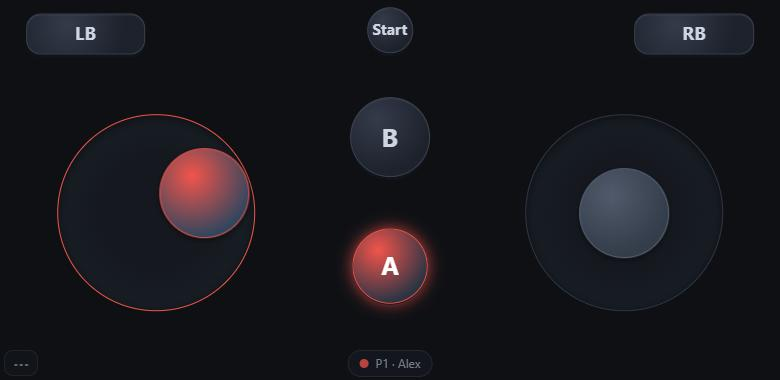
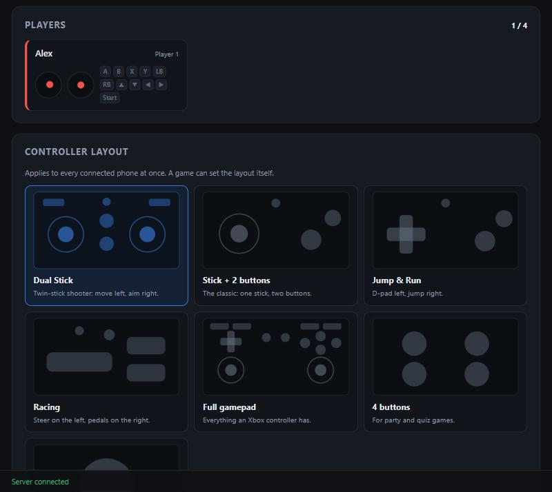
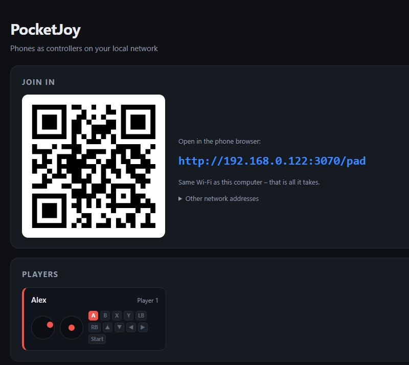

# PocketJoy

**Turn phones into game controllers over the local network.** Built for couch
co-op: everyone sits on the sofa, picks up their own phone, and plays. No app
to install, no pairing, no cables — your friends open a link and they are in.



```bash
npm install
npm start
```

The terminal prints a URL and a QR code. Scan it with a phone on the same
Wi-Fi, and that phone is player 1.

---

## Two ways to use it

**Local mode** — a small Node server runs next to your game. Phones connect to
it over your Wi-Fi. This is the simple case, and the only one that can also
present the phones to the operating system as real Xbox-style gamepads
(Windows and Linux), so even games that know nothing about PocketJoy can use
them.

**Web mode** — for a game hosted somewhere like itch.io. The game page runs
the player management itself and phones connect **directly** to it over
WebRTC, found through a short room code. Nobody installs anything, and a
browser rule that forbids a hosted page from reaching into a local network
does not apply. Only a tiny signalling service is needed to introduce the two
sides; once connected, input flows straight from phone to game — tested by
stopping the server mid-game and watching play continue.

Both modes share the same protocol, the same controller UI and the same game
API. Your game code does not change.

---

## Using it in your game

Copy `client/pocketjoy.js` into your project:

```js
import { PocketJoy } from './pocketjoy.js';

const pj = new PocketJoy({ layout: 'dual-stick', maxPlayers: 4 });
await pj.connect();

function frame() {
  for (const p of pj.players) {
    const move = p.dir('left');         // { x, y, len, angle }
    ship[p.slot].x += move.x * 5;

    if (p.pressed('a')) shoot(p);       // true on the frame it goes down
    if (p.down('rt')) accelerate(p);    // true while held
  }

  pj.update();                          // end of frame: clears pressed()
  requestAnimationFrame(frame);
}
```

| Call | Meaning |
|---|---|
| `p.down('a')` | button held right now |
| `p.pressed('a')` / `p.released('a')` | changed since the last `pj.update()` |
| `p.stick('left')` / `p.dir('right')` | stick as a vector, with or without deadzone |
| `p.rumble(200)` | buzz that phone |
| `p.kick()` | remove that player |
| `p.slot` `p.name` `p.color` | seat number, name, colour |

Events: `join`, `leave`, `press`, `release`, `player`, `layout`, `connect`,
`disconnect`, `error`.

Buttons are Xbox-standard (`a b x y lb rb lt rt back start ls rs` and the
d-pad), axes are `lx ly rx ry lt rt`. As in the browser Gamepad API, **`y = -1`
is up**. A d-pad is mirrored onto the left stick, so a game reading
`stick('left')` works with every layout.

---

## Layouts

The game decides what appears on every phone — nobody has to pick anything.



```js
pj.setLayout('racing');                  // switch mid-game
pj.setLayout('buttons', true);           // ... and keep the lobby out of it
```

Seven presets ship with it: `dual-stick`, `single-stick`, `platformer`,
`racing`, `gamepad`, `buttons`, `buzzer`. A game can also bring its own:

```js
pj.setLayout({
  name: 'Fishing',
  controls: [
    { kind: 'stick',  id: 'left', x: 22, y: 55, size: 55 },
    { kind: 'button', id: 'a', x: 72, y: 62, size: 30, label: 'Cast' },
  ],
});
```

Every layout is validated before it reaches the phones: unknown control types
are dropped, values outside the screen are clamped, and a layout with nothing
usable is rejected. A typo cannot leave your players with an unusable
controller.

---

## In the room



- **One phone, one player.** Opening the controller twice takes the seat over
  rather than claiming a second one. That is also what makes rejoining
  instant after a dropped Wi-Fi connection — same seat, same name.
- **The first phone runs the round.** It gets an overview on its own screen:
  remove players, switch the layout for everyone. If it leaves, the next
  phone takes over.
- **Landscape without asking.** Hold the phone upright and the controller
  turns itself — no orientation lock, no "please rotate" message.
- **Eight languages**, picked from each phone's own browser settings, so a
  mixed group each sees their own. English, German, Spanish, French, Italian,
  Portuguese, Russian, Chinese.
- **Latency** is about 1 ms on top of the Wi-Fi hop. Measured up to 48
  controllers at once (1570 packets/s) without loss — see
  `scripts/loadtest.mjs`.

---

## Real gamepads (Windows and Linux)

For games that know nothing about PocketJoy — Steam, Unity, Godot, emulators:

```bash
pip install websockets vgamepad     # Windows
pip install websockets evdev        # Linux
python bridge/pocketjoy_bridge.py
```

Each phone then shows up as a virtual Xbox 360 controller. Setup, Linux
permissions and troubleshooting: [bridge/README.md](bridge/README.md). Try it
without installing anything first with `--dry-run`.

> Not yet verified against real driver hardware — the connection and mapping
> are tested, the driver layer is not.

---

## Security

PocketJoy is built for a living room, and it has **no access control**:
anyone who can reach the server can join as a player. On your own Wi-Fi that
is the point. Before putting it on the public internet, understand that:

- the room code in web mode is the only barrier, and it is short;
- the local mode has no barrier at all beyond your network;
- there is no authentication, no encryption of game traffic beyond what
  WebRTC provides, and no rate limiting per player.

TURN credentials, if you configure a relay, are generated per connection with
a short expiry and never leave the server. See the "Hosted games" section of
the [German documentation](docs/README.de.md) for a full setup.

---

## Project layout

```
server/index.js      HTTP + WebSocket, LAN address detection, QR code
server/signaling.js  room introductions for web mode (never sees input)
shared/hub.js        player seats and input routing — runs in the server
                     OR inside the game's page (web mode)
shared/protocol.js   buttons, axes, layouts
shared/rtc.js        WebRTC transport
client/pocketjoy.js      library for your game (local mode)
client/pocketjoy-web.js  same API for hosted games
web/pad/             the controller UI phones open
web/host/            the lobby
examples/            two demo games, one per mode
bridge/              Python bridge for real system gamepads
```

## Tests

```bash
npm test
```

Checks layout geometry against four phone aspect ratios, verifies all eight
translations, then runs 108 end-to-end checks against a real server with
simulated phones and a real game: seats, input, triggers, rumble, layout
switching, reconnects, packet loss recovery, the main controller's
permissions, and that the server serves no files outside its own folders.

## License

MIT — see [LICENSE](LICENSE).

Full documentation (German): [docs/README.de.md](docs/README.de.md)
